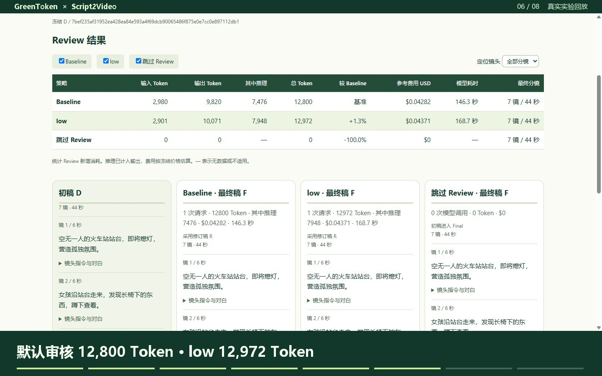

# GreenToken × Script2Video

输入一段剧本，生成并冻结一份分镜初稿，再比较三种审核策略。实验台把逐镜内容、推理 Token、耗时和参考费用放在同一页。

[](demo/GreenToken-demo.mp4)

**[观看 87 秒中文演示](demo/GreenToken-demo.mp4)** · [中文字幕](demo/GreenToken-demo.zh.srt) · [下载车站案例的交互回放](demo/station-replay.html)

想直接看成果，可以下载 HTML 后在浏览器打开。视频前半段是离线操作录屏，后半段是保存的真实 DeepSeek 实验，点击回放中的「镜头指令与对白」可以看到具体文本。

## 一个真实案例

女孩在车站捡起红手套，赶在车门关闭前递给老人。生成这份 7 镜、44 秒的分镜共用 10,328 Token，参考费用为 0.03584 美元。下表仅列各策略新增的审核消耗。

| 策略 | 总 Token | 其中推理 Token | 参考费用（美元） | 模型耗时 | 最终分镜 |
|---|---:|---:|---:|---:|---|
| Baseline 默认审核 | 12,800 | 7,476 | 0.04282 | 146.3 秒 | 7 镜 / 44 秒 |
| low 低思考强度 | 12,972 | 7,948 | 0.04371 | 168.7 秒 | 7 镜 / 44 秒 |
| 跳过审核 | 0 | — | 0 | — | 7 镜 / 44 秒 |

逐字段核对发现，Baseline 改写了 7 镜的视频提示词。low 和跳过审核的最终镜头字段均与初稿一致。推理用量已经计入输出，费用按本次实验冻结的价格计算。每种审核策略各运行一次，结果只描述这个案例。

## 运行实验台

需要 Node.js 24 和 npm。在仓库根目录执行：

```sh
npm ci
npm test
npm start
```

打开 [本地离线实验台](http://127.0.0.1:4180)。离线模式使用模拟响应，可以输入剧本、冻结初稿、选择策略、导出回放。页面的「雨夜校园」案例使用已保存的真实审核数据。

如需自己运行真实实验，通过操作系统为运行进程设置 `DEEPSEEK_API_KEY` 后执行 `npm run live`，打开 [本地真实实验台](http://127.0.0.1:4181)。模型为 `deepseek-v4-pro`。生成调用一次，每个选中的审核策略各调用一次，Skip 在本地执行。运行前界面会提示本次调用次数。结果保存在本机的 `.review-experiments/local-lab/`。

## 实现位置

| 位置 | 内容 |
|---|---|
| [实验台](projects/local-lab/) | 本地 HTTP 服务、冻结初稿与运行记录、并排比较、独立 HTML 导出 |
| [策略与度量](projects/script2video/lib/greentoken/) | 参数白名单、默认与低思考强度对照、费用和用量解析 |
| [DeepSeek 调用](projects/script2video/lib/providers/deepseek.ts) | 请求、响应诊断、取消、超时和用量采集 |
| [分镜提示词](projects/script2video/lib/prompts/storyboard.ts) | 初稿、审核与结果解析 |
| [历史展示页](projects/showcase/) | 雨夜校园案例、审核结果、人工质量评价与观察模式 |
| [离线端到端测试](tools/test-local-lab.mjs) | 冻结一致性、策略参数、失败回退、重复调用保护和回放导出 |

本仓库是组合实验台的独立发布版。Script2Video 相关源码的上游版权与许可见 [MIT License](projects/script2video/LICENSE)。

